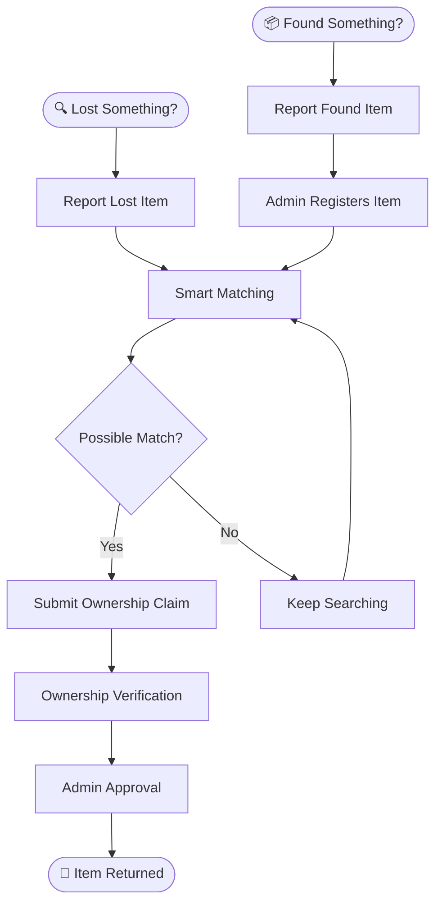

<div align="center">

# 🔎 CAMPUSFIND

### INTELLIGENT COLLEGE LOST & FOUND PORTAL


<br>

**Lost. Found. Reunited.**

A smarter way to reconnect students with their lost belongings.

<br>


</div>

---

## ⚡ What is CampusFind?

Ever lost something on campus and had no idea where to look?

**CampusFind is here to change that.**

A centralized lost and found platform that helps students report missing belongings, discover possible matches, and recover their items through secure ownership verification.

No more endless searching. No more guessing.

Just a smarter way to find what matters.

---

## 🚀 Features That Make It Different

<table>
<tr>
<td width="50%">

### 🔍 Smart Item Matching

Find possible matches between lost and found reports using item information.

### 📸 Easy Reporting

Report lost or found belongings with item details and photographs.

### 🔐 Ownership Verification

Protect found items with private verification details.

</td>
<td width="50%">

### 👤 Student Portal

Register, log in, manage reports, and track claims.

### 🛡️ Admin Control

Manage found items, review claims, and approve item returns.

### 🔔 Notifications

Receive updates about claims and recovery progress.

</td>
</tr>
</table>

---

## 🧠 How CampusFind Works



---

## 🛠️ Built With

| Technology | Purpose |
|---|---|
| HTML, CSS, JavaScript | Frontend |
| Python, FastAPI | Backend |
| Supabase PostgreSQL | Cloud Database |
| SQLite | Local Database |
| JWT | Authentication |
| Bcrypt | Password Security |

---

## 📂 Project Structure

```text
campusfind/
├── backend/
│   ├── main.py
│   ├── auth.py
│   ├── database.py
│   ├── model.py
│   ├── schemas.py
│   ├── matching.py
│   ├── verification.py
│   ├── emailer.py
│   └── requirements.txt
│
├── frontend/
│   ├── index.html
│   ├── css/
│   │   └── style.css
│   └── js/
│       ├── api.js
│       └── app.js
│
└── database/
    └── schema.sql
```

---

## 💻 Get Started

### 1. Clone the Repository

```bash
git clone YOUR_GITHUB_REPOSITORY_URL
cd campusfind
```

### 2. Create a Virtual Environment

```bash
python -m venv venv
```

Activate it on Windows:

```bash
venv\Scripts\activate
```

### 3. Install Dependencies

```bash
pip install -r backend/requirements.txt
```

### 4. Configure Your Database

Configure your database connection in the backend settings.

For Supabase, create a project and configure its PostgreSQL connection. Use `database/schema.sql` to set up the database tables.

### 5. Run CampusFind

```bash
cd backend
uvicorn main:app --reload
```

Open your browser:

**http://localhost:8000**

API documentation:

**http://localhost:8000/docs**

---

## 🔮 What's Next?

- 🤖 AI-powered image matching
- 📱 Mobile application
- 🏷️ QR-based item identification
- 🎓 College ID integration
- ☁️ Secure cloud image storage

---

<div align="center">

## 👩‍💻 Created By

### Johara Shaikh

**Individual Project**

*CampusFind — Intelligent College Lost & Found Portal*

<br>

### 💙 Lost Today. Found Tomorrow.

*Making campus recovery smarter, one item at a time.*

</div>
