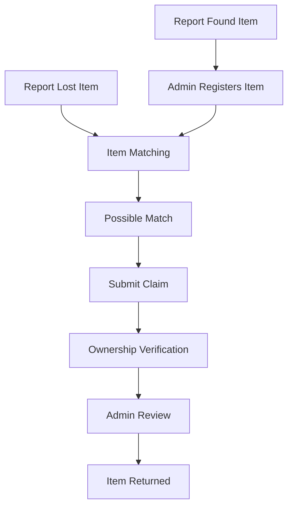

<div align="center">

# 🔎 CampusFind

### Intelligent College Lost & Found Portal

*Lost. Found. Reunited.*

A smart and secure platform to help students recover their lost belongings through intelligent item matching and ownership verification.


</div>

---

## 📌 About

CampusFind is a college lost and found portal that connects students with their lost belongings.

It allows students to report lost or found items, receive possible match suggestions, and verify ownership before collecting an item.

The system protects private item details and provides an administrator-controlled recovery process.

## ✨ Features

- 👤 Student registration and login
- 🔍 Lost and found item reporting
- 📸 Item photo upload and camera capture
- 🤖 Intelligent item matching
- 🔐 Private ownership verification
- 📋 Claim tracking and admin approval
- 🔔 Email notifications and password reset
- 🛡️ Secure administrator dashboard

## 🔄 How It Works



## 🛠️ Technology Stack

| Component | Technology |
|---|---|
| Frontend | HTML, CSS, JavaScript |
| Backend | Python, FastAPI |
| Database | Supabase PostgreSQL |
| Local Database | SQLite |
| Authentication | JWT |
| Password Security | Bcrypt |

## 📂 Project Structure

```text
campusfind/
├── backend/
│   ├── main.py
│   ├── auth.py
│   ├── database.py
│   ├── model.py
│   ├── schemas.py
│   ├── matching.py
│   ├── verification.py
│   ├── emailer.py
│   └── requirements.txt
├── frontend/
│   ├── index.html
│   ├── css/style.css
│   └── js/
│       ├── api.js
│       └── app.js
├── database/
│   └── schema.sql
├── prototype/
│   └── campusfind-demo.html
├── .env.example
└── README.md
```

## 🚀 Getting Started

### Prerequisites

- Python 3.10 or newer
- Visual Studio Code
- Web browser

### 1. Clone the Repository

```bash
git clone YOUR_GITHUB_REPOSITORY_URL
cd campusfind
```

### 2. Create a Virtual Environment

```bash
python -m venv venv
```

Activate it on Windows:

```bash
venv\Scripts\activate
```

### 3. Install Dependencies

```bash
pip install -r backend/requirements.txt
```

### 4. Configure Environment

Copy `.env.example` into the `backend` folder and rename it to `.env`.

Add your secret key and administrator email.

```env
DATABASE_URL=
SECRET_KEY=your_secret_key
ADMIN_EMAILS=your_email@example.com
```

Leave `DATABASE_URL` empty to use SQLite locally.

### 5. Run the Application

```bash
cd backend
uvicorn main:app --reload
```

Open the application:

**http://localhost:8000**

API documentation:

**http://localhost:8000/docs**

## 🗄️ Database Setup

CampusFind supports SQLite for local development and Supabase PostgreSQL for cloud storage.

To connect Supabase:

1. Create a Supabase project.
2. Copy your PostgreSQL connection string.
3. Add it to `DATABASE_URL` in `backend/.env`.
4. Start the backend.

The application creates the required tables automatically.

## 🔐 Security

- Passwords are stored as hashes.
- JWT authentication protects user accounts.
- Found item details remain private.
- Ownership verification protects against false claims.
- Administrator approval controls item recovery.

## 🔮 Future Enhancements

- AI-based image matching
- QR code item identification
- Mobile application
- College ID integration
- Secure cloud image storage

---

<div align="center">

## 👩‍💻 Project Developer

**Johara Shaikh**

*Individual Project*

**CampusFind — Intelligent College Lost & Found Portal**

</div>

---

<div align="center">

*Making lost belongings easier to find and return.*

</div>
